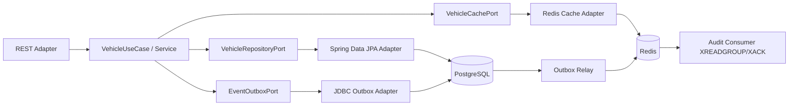
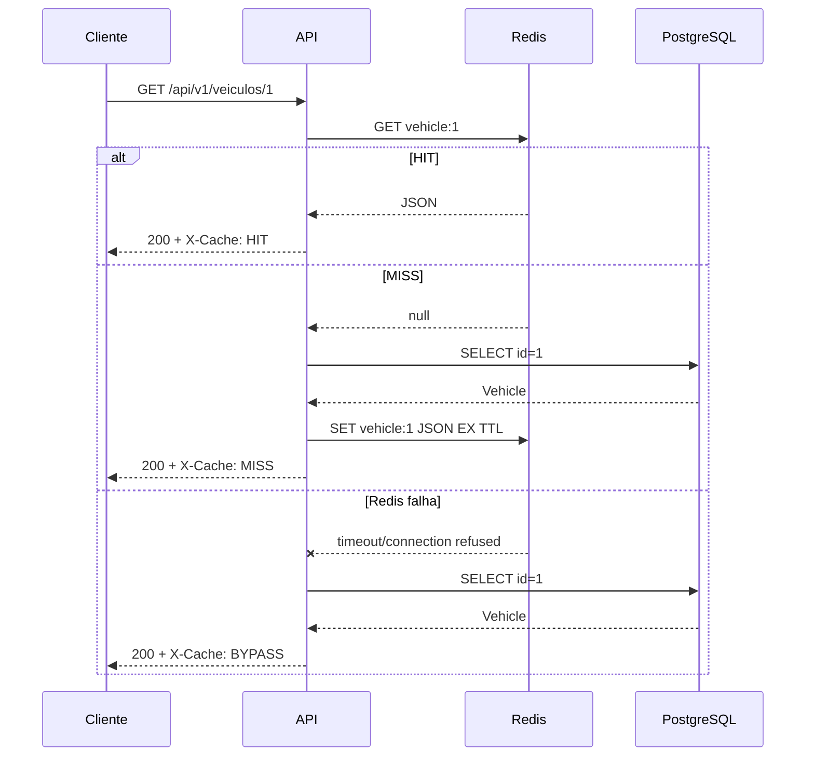

# Decisões arquiteturais e experimentos

## Hexagonal — dependências



## Leitura: Cache-Aside



## Escrita: PostgreSQL + cache pós-commit + outbox

```mermaid
sequenceDiagram
    participant C as Cliente
    participant A as VehicleService
    participant P as PostgreSQL
    participant R as Redis
    participant O as OutboxRelay
    C->>A: PUT /api/v1/veiculos/1
    A->>P: BEGIN; UPDATE vehicles; INSERT outbox_events
    P-->>A: COMMIT
    A->>R: SET vehicle:1 nova versão + TTL (AFTER_COMMIT)
    A-->>C: 200 (banco persistido)
    O->>P: SELECT pending outbox
    O->>R: XADD stream:veiculos * ...
    O->>P: UPDATE outbox_events published_at
```

### Trade-offs explícitos

1. **Não há transação distribuída entre PostgreSQL e Redis.** A escrita no cache é best-effort após commit. Uma falha pode deixar stale data até o TTL. Reconciliar e versionar entradas é evolução necessária para SLOs rígidos.
2. **Redis Streams é at-least-once neste desenho.** Outbox pode repetir XADD se falhar após publicar e antes de atualizar `published_at`. Consumidores precisam deduplicar pelo `eventId`.
3. **O audit consumer não reprocessa mensagens pendentes após crash** neste primeiro estágio: consome apenas novas entradas com `>`; exercitar `XPENDING`, `XAUTOCLAIM` é evolução deliberada.
4. **OutboxRelay single-instance**, sem lock distribuído. Subir múltiplas réplicas pode causar publicações duplicadas mesmo sem falhas.
5. **Write-Through didático**: aplicação faz PostgreSQL primeiro e cache pós-commit; isso não garante atomicidade nem linearizabilidade de leituras.
6. PostgreSQL é a fonte de verdade. Redis indisponível → `GET` continua pelo banco; `POST`/`PUT`/`DELETE` persistem no banco, com evento durável no outbox.
7. Mesmo com sincronização pós-commit, uma leitura simultânea pode popular o cache com uma versão antiga; produção precisa CAS/Lua/versioned cache keys ou invalidação coordenada para requisitos fortes.
8. A configuração Redis usa `noeviction` para impedir que pressão de memória remova eventos do Stream sem aviso; sob falta de memória, escritas no Redis falham e o outbox permanece pendente. Em produção, isole Redis Cache (volátil) e Redis Streams (persistência) em instâncias separadas, com políticas de memória, persistência e replicação adequadas.

## Experimentos de falha

**Cache hit/miss:** limpar a chave (`DEL vehicle:ID`), realizar 2 GETs e verificar `X-Cache`.

**TTL:** `TTL vehicle:ID`; espere expirar e repita GET.

**Redis indisponível:** `docker compose stop redis`; GET deve retornar `X-Cache: BYPASS` enquanto PostgreSQL estiver saudável. POST/PUT pode retornar sucesso, porém outbox ficará pendente. `docker compose start redis` e aguarde o relay.

**Evento:** `docker compose exec redis redis-cli XRANGE stream:veiculos - + COUNT 10`.

**Pendências de auditoria:** `docker compose exec redis redis-cli XPENDING stream:veiculos grupo-auditoria`.

**Outbox pendente:** `docker compose exec postgres psql -U vehicle -d vehicledb -c 'SELECT id, event_type, published_at FROM outbox_events ORDER BY created_at DESC LIMIT 10'`.

## Produção: próximos incrementos

- Testcontainers e testes de integração; autenticação e autorização; TLS; segregação Redis por função.
- Metrics de cache, latência p95/p99, lag do outbox, PEL pendente, dashboards Grafana.
- Tratamento de poison message e DLQ operacional, `XAUTOCLAIM`, idempotência persistida.
- Cache stampede: singleflight, locks distribuídos ou expiração com jitter.
- Outbox concorrente: lease com `FOR UPDATE SKIP LOCKED` e lock transacional.
- Controle de consistência: versionamento por chave e CAS Lua, reconciliação/invalidação.
